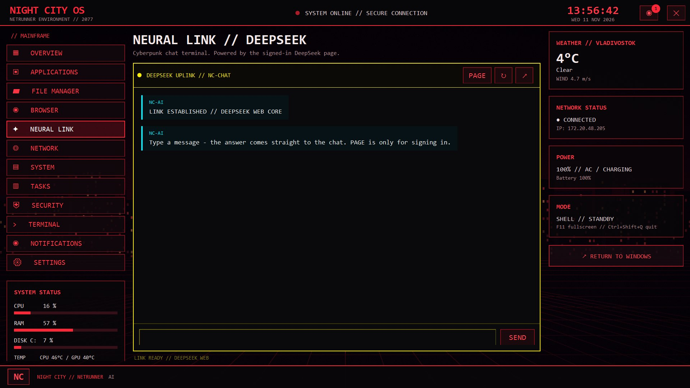

# NIGHT CITY OS // RED NETRUNNER EDITION v7.0


Оболочка Windows в стиле Cyberpunk 2077: WPF-интерфейс, Chromium-браузер,
DeepSeek внутри оболочки, программы в окне оболочки, файловый менеджер, сеть.

---

## 💰 Поддержать проект

Если вам нравится NightCity OS и вы хотите поддержать разработку:

👉 [**Поддержать на DonationAlerts**](https://www.donationalerts.com/r/kisllik)

Большое спасибо за поддержку! 🎉

## Запуск

- `NightCityShell.cmd` — запустить (без окна консоли).
- `NightCityShell.vbs` — то же самое, используется автозапуском.
- Выход: **RETURN TO WINDOWS**, Alt+F4 или **Ctrl+Shift+Q**.

## Горячие клавиши

| Клавиша | Действие |
|---|---|
| **F11** | полноэкранный режим, повторно — вернуть |
| **Esc** | выйти из полноэкранного режима |
| **Ctrl+L** | фокус в адресную строку |
| **F5** | обновить страницу |
| **Ctrl+Shift+Q** | аварийный выход |

## NEURAL LINK // DeepSeek

Встроена веб-версия DeepSeek (`chat.deepseek.com`) в отдельной вкладке-панели:

- вход выполняется один раз прямо в панели, сессия сохраняется в
  `%LOCALAPPDATA%\NightCity\WebView2AI`;
- тёмная тема, сканлайны и красная виньетка встроены в страницу, чтобы совпадать
  с интерфейсом оболочки;
- рамка в стиле терминала: `SECURE UPLINK // DEEPSEEK`, кнопки RELOAD / HOME / ↗.

## Браузер и видео

Встроен Chromium (WebView2, Edge 157), RuTube и YouTube воспроизводят видео.

- при полноэкранном видео плеер разворачивается на весь экран — панели оболочки
  и адресная строка скрываются автоматически;
- в адресной строке есть кнопка **⛶** — принудительный полноэкранный режим;
- **F11** делает то же самое;
- кнопка **↗** открывает адрес в системном браузере.

Движок лежит в `lib` (обязательна):

```
lib\Microsoft.Web.WebView2.Core.dll
lib\Microsoft.Web.WebView2.Wpf.dll
lib\WebView2Loader.dll
```

Без папки `lib` оболочка откатывается на IE11.

## Программы внутри оболочки

NOTEPAD, CMD, POWERSHELL, TASK MANAGER, MMC встраиваются в окно оболочки,
в шапке `RUNNING // ИМЯ`, кнопки **↗** (отцепить) и **✕** (закрыть).
Explorer, Панель управления и Калькулятор открываются обычными окнами.

## Автозапуск

`wscript.exe //B "<путь-к-папке>\NightCityShell.vbs"`, explorer.exe не заменяется.

Отключить:

```
powershell -ExecutionPolicy Bypass -File .\Install-NightCityShell.ps1 -Uninstall
```

## Масштаб интерфейса

Размеры подгоняются под экран: коэффициент = ширина экрана / 1280 (0.75–1.8).

## Файлы

```
NightCityShell.ps1              приложение
NightCityWallpaper.png          обои
NightCityShell.vbs              запуск без консоли (автозапуск)
NightCityShell.cmd              запуск вручную
Install-NightCityShell.ps1      автозапуск вкл/выкл
lib\                            Chromium-движок WebView2
README.md                       этот файл
```

## Логи

`%LOCALAPPDATA%\NightCity\logs\shell.log`
## NEURAL LINK // чат

Вкладка NEURAL LINK теперь - собственный чат в стиле Cyberpunk 2077:

- запросы уходят на страницу DeepSeek (DOM), ответы читаются оттуда же;
- кнопка **PAGE** показывает саму страницу (для входа в аккаунт), **CHAT** возвращает чат;
- сессия DeepSeek хранится в %LOCALAPPDATA%\NightCity\WebView2AI.

## Видео без полос

При полноэкранном видео плеер растягивается на весь экран с обрезкой полей
(object-fit: cover), поэтому сверху и снизу не остаётся чёрных полос.
Кнопка **⛶** в адресной строке и **F11** включают полный экран вручную.

## Датчики и время

- часы справа сверху идут по локальному времени системы, обновление раз в секунду;
- CPU TEMP берется из тепловых зон Windows (`Win32_PerfFormattedData_...ThermalZoneInformation`),
  GPU TEMP - из `nvidia-smi` (NVIDIA). Если датчика нет, показывается `--`;
- CPU / RAM / диск обновляются раз в 8 секунд.

## Замена рабочего стола

Режим `DESKTOP // OURS` останавливает explorer.exe: панель задач и стандартный
рабочий стол больше не работают в фоне, их место занимает оболочка.

- включить/выключить: SETTINGS -> DESKTOP // STOCK/OURS;
- вернуть Windows: кнопка **RETURN TO WINDOWS** (поднимает explorer.exe и снимает режим);
- режим уже включен и применится при следующем запуске оболочки.

## Память

- чат опрашивает страницу только когда открыт NEURAL LINK;
- статистика снимается раз в 8 секунд, датчики - быстрыми WMI-классами;
- браузер и чат используют общий профиль Chromium; при выходе WebView2 освобождается.
## Чат без кнопки PAGE

Чат общается со страницей DeepSeek напрямую: текст вставляется в textarea,
нажимается основная кнопка отправки (`.ds-button--primary`), ответ читается
из `.ds-markdown` и стримится в чат. Страница рендерится в полном размере
1000x800 за пределами окна, поэтому DeepSeek не включает мобильный режим
без кнопки отправки. Кнопка PAGE нужна только для входа в аккаунт.
## Погода и русификация

- Погода Владивостока (Open-Meteo, без ключа): температура, состояние, ветер.
  Обновление каждые 15 минут.
- Полная русификация интерфейса: переключатель **LANGUAGE // ЯЗЫК** (EN-RU)
  в SETTINGS, выбор сохраняется между запусками.
## Стабильность и оптимизация (v7.0)

- убран фоновый обход дерева интерфейса каждые 1.5 с (русификация теперь по событию);
- статистика снимается раз в 10 с, путь nvidia-smi кэшируется;
- чат опрашивает страницу только при открытом NEURAL LINK, интервал 0.5 с;
- таймеры и WebView2 корректно останавливаются при выходе.

## Рабочий стол Windows

- SETTINGS -> **ПРИМЕНИТЬ СЕЙЧАС** останавливает explorer.exe: панель задач
  и стандартный рабочий стол перестают работать в фоне, их место занимает оболочка;
- вернуть как было: **ВЕРНУТЬСЯ В WINDOWS** или SETTINGS -> РАБОЧИЙ СТОЛ -> СТАНДАРТНЫЙ;
- при автозапуске режим применяется сам (флаг в HKCU\Software\NightCityOS).

## Дизайн v7.0

- Единая дизайн-система: панели, кнопки, вкладки, hover-подсветка, неоновые рамки.
- Плавное появление разделов (fade 160 мс), анимированный индикатор сети.
- Тонкий сканлайн-слой поверх стола, перспективная сетка на обоях.
- Всплывающие уведомления (toast) и Центр уведомлений со счётчиком.
- Новые разделы: ЗАДАЧИ (реальные процессы), БЕЗОПАСНОСТЬ (Defender, брандмауэр,
  UAC, Secure Boot, BitLocker), УВЕДОМЛЕНИЯ, УПРАВЛЕНИЕ СИСТЕМОЙ.
- Терминал в меню открывает PowerShell внутри оболочки.
- Все новые строки переведены, данные только реальные (иначе «НЕТ ДАННЫХ»).

## Файлы

- NightCityShell.ps1 — оболочка (v7.0)
- backup\NightCityShell.v6.0.ps1 — резервная копия до редизайна
- README.md, Install-NightCityShell.ps1, NightCityShell.cmd/.vbs, lib\

